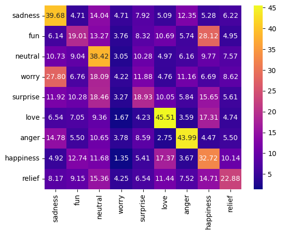

# Detector de emociones en texto

**English summary.** A two-layer LSTM (Keras) that classifies short English tweets into 9 emotions. Trained on 39,173 labelled tweets with class weighting and early stopping. Best validation accuracy is **0.286** against a 0.225 majority-class baseline, which shows how hard this noisy, single-label dataset is; the row-normalised confusion matrix below shows where the model succeeds (love, anger, sadness, neutral) and where it fails (worry, the largest class after neutral, is almost never predicted).

---

## Descripción

Clasificador de emociones para tweets cortos en inglés. El notebook [`Codigo.ipynb`](Codigo.ipynb) (ejecutado en Google Colab) contiene todo el flujo: limpieza, tokenización, modelo, evaluación y una función `emociones(texto)` que regresa las 2 emociones más probables.

## Datos

`tweet_emotions.csv`: 40,000 tweets etiquetados con 13 emociones. Se eliminan las filas con etiqueta `empty` y se fusionan clases muy pequeñas (`hate` en `anger`, `boredom` en `neutral`, `enthusiasm` en `fun`), quedando **39,173 tweets y 9 clases**:

| neutral | worry | happiness | sadness | love | fun | surprise | relief | anger |
|---|---|---|---|---|---|---|---|---|
| 22.5% | 21.6% | 13.3% | 13.2% | 9.8% | 6.5% | 5.6% | 3.9% | 3.7% |

## Modelo

* Limpieza con expresiones regulares, tokenización con NLTK y eliminación de stopwords.
* Vocabulario de 3,000 palabras (`<OOV>` para el resto), secuencias de 12 tokens.
* Embedding (128) → LSTM (128) → LSTM (64) → Dense (128) + Dropout 0.5 → softmax (9).
* Pesos de clase balanceados (`compute_class_weight`) para compensar el desbalance.
* Partición 80/20, Adam, early stopping sobre `val_loss` con paciencia 5 y restauración de los mejores pesos.

## Resultados

* Mejor época (4 de 9 antes del early stopping): `val_loss` 1.927, **accuracy de validación 0.286**.
* Línea base de clase mayoritaria (`neutral`): 0.225.

Matriz de confusión normalizada por fila (%, filas = clase real):

Las clases con más recall son `love` (45.5%), `anger` (44.0%), `sadness` (39.7%) y `neutral` (38.4%). `worry` casi nunca se predice (4.2%) y se confunde sobre todo con `sadness`.

## Cómo ejecutarlo

1. Abrir `Codigo.ipynb` en Google Colab o Jupyter con `tensorflow`, `nltk`, `scikit-learn`, `pandas` y `seaborn` instalados.
2. Colocar `tweet_emotions.csv` junto al notebook y ejecutar todas las celdas.
3. Probar con `emociones("I can't wait for the weekend!")`.

`codigo.py` es una versión en script del mismo código que solo usa las primeras 2,000 filas para pruebas rápidas; los resultados de arriba corresponden al notebook.

## Limitaciones

* La precisión es baja en términos absolutos: las etiquetas del dataset son ruidosas y muchas emociones se solapan (worry y sadness, fun y happiness).
* Con pesos balanceados, la accuracy no es la mejor métrica; el F1 macro sería más informativo y aún no se calcula.
* Secuencias de 12 tokens y vocabulario de 3,000 palabras recortan información; un modelo preentrenado (por ejemplo un transformer) sería la siguiente comparación natural.
* Solo funciona en inglés.
